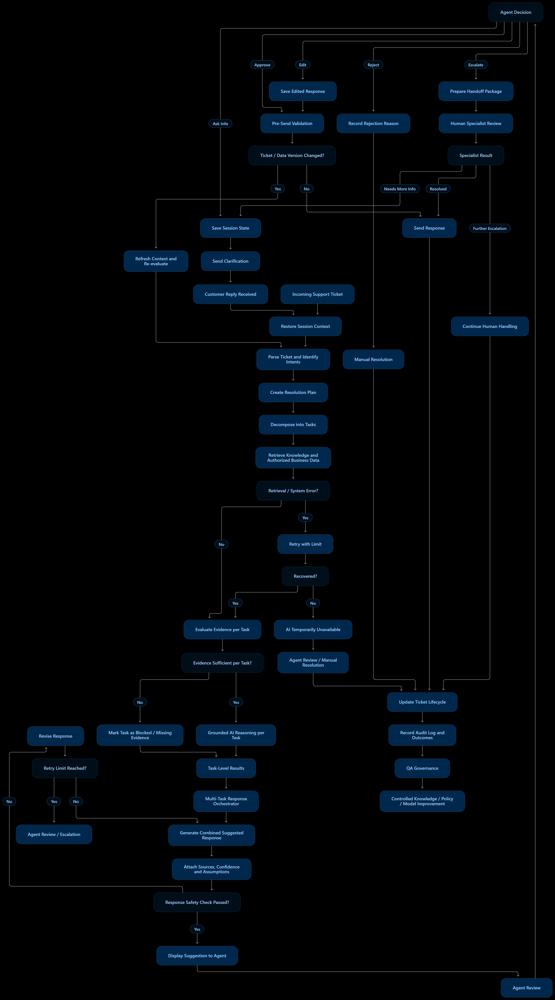

ĐỀ XUẤT GIẢI PHÁP
AI GỢI Ý PHẢN HỒI CHO TICKET HỖ TRỢ
[US-01] Với vai trò nhân viên hỗ trợ, tôi muốn xem các câu trả lời do AI đề xuất để xử lý ticket nhanh hơn.
1. User Story
[US-01] Với vai trò nhân viên hỗ trợ, tôi muốn xem các câu trả lời do AI đề xuất để có thể giải quyết ticket nhanh hơn.
2. Mục tiêu
Cung cấp cho nhân viên hỗ trợ một câu trả lời được AI soạn thảo dựa trên nội dung ticket, ngữ cảnh hội thoại, tài liệu kiến thức và dữ liệu nghiệp vụ được phép truy cập. Nhân viên có thể xem, chỉnh sửa, chấp thuận, từ chối hoặc yêu cầu thêm thông tin trước khi gửi.
Mục tiêu chính là giảm thời gian soạn phản hồi, cải thiện tính nhất quán và hỗ trợ nhân viên xử lý ticket hiệu quả hơn; AI không tự gửi phản hồi trong phạm vi MVP.
3. Phạm vi MVP đề xuất
Bao gồm:
•	Phân tích nội dung ticket và xác định một hoặc nhiều ý định/yêu cầu.
•	Chia ticket nhiều ý định thành các tác vụ nhỏ để xử lý riêng.
•	Truy xuất tài liệu kiến thức và dữ liệu nghiệp vụ mà người dùng/hệ thống được phép xem.
•	Tạo phản hồi đề xuất có căn cứ, kèm nguồn tham khảo, mức độ tin cậy và giả định (nếu có).
•	Cho phép nhân viên hỗ trợ xem xét, chỉnh sửa, chấp thuận, từ chối, yêu cầu làm rõ hoặc chuyển tiếp.
•	Kiểm tra ticket và dữ liệu có còn mới trước khi nhân viên gửi phản hồi.
•	Ghi nhật ký kiểm toán và thu thập phản hồi phục vụ QA, cải tiến có kiểm soát.
Không bao gồm trong MVP:
AI tự thực hiện hành động nghiệp vụ như cập nhật tồn kho, tạo đơn hàng, hoàn tiền, thay đổi thông tin CRM hoặc thực thi giao dịch. Các hành động này là phần mở rộng cho giai đoạn sau.
4. Quy trình đề xuất
1.	Tiếp nhận ticket: Hệ thống nhận ticket mới hoặc ticket được cập nhật.
2.	Khôi phục ngữ cảnh phiên: Nạp lịch sử hội thoại, trạng thái ticket và các thông tin liên quan trong phạm vi được phép.
3.	Phân tích ticket: AI xác định ý định, câu hỏi, thông tin đã cung cấp và thông tin còn thiếu.
4.	Lập kế hoạch xử lý: Nếu ticket có nhiều yêu cầu, hệ thống tách thành các tác vụ riêng và xác định quan hệ phụ thuộc nếu có.
5.	Truy xuất dữ liệu: Tìm kiếm tài liệu kiến thức và dữ liệu nghiệp vụ phù hợp, tuân thủ quyền truy cập.
6.	Xử lý lỗi truy xuất: Nếu có lỗi kỹ thuật như timeout hoặc API không khả dụng, thử lại có giới hạn. Nếu vẫn lỗi, thông báo dữ liệu tạm thời không khả dụng và đưa ticket về quy trình xử lý thủ công.
7.	Đánh giá bằng chứng theo từng tác vụ: Xác định tác vụ nào có đủ căn cứ để trả lời, tác vụ nào cần hỏi thêm hoặc chuyển nhân viên chuyên trách. Không chặn toàn bộ ticket chỉ vì một tác vụ thiếu thông tin.
8.	Tạo câu trả lời có căn cứ: Với từng tác vụ đủ bằng chứng, AI soạn nội dung dựa trên nguồn đã truy xuất. Không tự suy đoán thông tin nghiệp vụ chưa được xác minh.
9.	Tổng hợp phản hồi: Điều phối viên tổng hợp kết quả các tác vụ thành một phản hồi thống nhất; nêu rõ phần đã trả lời và phần cần làm rõ nếu có.
10.	Đính kèm thông tin hỗ trợ: Hiển thị nguồn tham khảo, mức độ tin cậy và giả định/giới hạn liên quan để nhân viên có thể kiểm tra.
11.	Kiểm tra an toàn và chính sách: Kiểm tra nội dung, dữ liệu nhạy cảm, quyền truy cập và các chỉ dẫn không đáng tin cậy trong ticket/tài liệu. Nếu không đạt, thử điều chỉnh trong giới hạn; nếu vẫn không đạt thì yêu cầu nhân viên xem xét.
12.	Hiển thị cho nhân viên: Nhân viên xem đề xuất cùng nguồn và thông tin giải thích.
13.	Nhân viên xem xét: Nhân viên có thể chấp thuận, chỉnh sửa, từ chối, yêu cầu thêm thông tin hoặc chuyển ticket cho nhóm phù hợp.
14.	Kiểm tra tính mới trước khi gửi: Ngay trước khi gửi, kiểm tra ticket và dữ liệu liên quan có thay đổi không. Nếu đã thay đổi, làm mới ngữ cảnh và tạo lại đề xuất.
15.	Gửi phản hồi: Chỉ gửi sau thao tác chấp thuận của nhân viên. Cập nhật trạng thái ticket và ngữ cảnh hội thoại.
16.	Ghi nhận và cải tiến có kiểm soát: Ghi lại đề xuất, nguồn, quyết định/chỉnh sửa của nhân viên và kết quả. Dữ liệu phản hồi đi qua QA và quy trình quản trị trước khi cập nhật knowledge base, chính sách hoặc mô hình.
5. Sơ đồ luồng xử lý

Sơ đồ Mermaid (có thể dán vào công cụ hỗ trợ Mermaid để hiển thị sơ đồ):
flowchart TD
    A[Tiếp nhận ticket] --> B[Khôi phục ngữ cảnh]
    B --> C[Phân tích ý định và yêu cầu]
    C --> D[Tách thành các tác vụ]
    D --> E[Truy xuất kiến thức và dữ liệu được phép]
    E --> F{Truy xuất thành công?}
    F -- Không --> G[Thử lại có giới hạn]
    G --> H{Đã khôi phục?}
    H -- Không --> I[Thông báo lỗi tạm thời / xử lý thủ công]
    H -- Có --> J[Đánh giá bằng chứng theo từng tác vụ]
    F -- Có --> J
    J --> K{Tác vụ đủ căn cứ?}
    K -- Có --> L[Tạo câu trả lời có căn cứ]
    K -- Không --> M[Đề xuất hỏi làm rõ hoặc chuyển chuyên viên]
    L --> N[Tổng hợp phản hồi]
    M --> N
    N --> O[Đính kèm nguồn, độ tin cậy, giả định]
    O --> P[Kiểm tra an toàn và chính sách]
    P --> Q{Đạt yêu cầu?}
    Q -- Không --> R[Điều chỉnh có giới hạn]
    R --> S{Đạt sau điều chỉnh?}
    S -- Không --> T[Chuyển nhân viên xem xét]
    S -- Có --> U[Hiển thị đề xuất]
    Q -- Có --> U
    U --> V{Nhân viên quyết định}
    V -- Chấp thuận / chỉnh sửa --> W[Kiểm tra dữ liệu mới nhất]
    W --> X{Ticket/dữ liệu thay đổi?}
    X -- Có --> B
    X -- Không --> Y[Gửi phản hồi]
    V -- Hỏi thêm --> Z[Hỏi khách hàng / chờ trả lời]
    Z --> B
    V -- Từ chối / chuyển tiếp --> AA[Chuyển xử lý thủ công]
    Y --> AB[Audit log và QA]
    AA --> AB
6. Các quyết định thiết kế và kiểm soát quan trọng
•	Đánh giá theo từng tác vụ: Ticket có nhiều ý định được chia nhỏ. Tác vụ đủ bằng chứng có thể được trả lời ngay, trong khi tác vụ khác được yêu cầu làm rõ hoặc chuyển tiếp.
•	Tách lỗi kỹ thuật khỏi thiếu bằng chứng: Thiếu thông tin cần hỏi khách hàng/chuyên viên; lỗi API hoặc timeout cần thử lại có giới hạn và thông báo tình trạng dịch vụ.
•	Vòng điều chỉnh có giới hạn: Không để AI lặp vô hạn. Sau số lần thử được cấu hình mà vẫn không đạt yêu cầu, chuyển cho nhân viên xem xét.
•	Nguồn và mức độ tin cậy: Mỗi đề xuất cần hiển thị nguồn, mức độ tin cậy và giả định để nhân viên đánh giá. Mức độ tin cậy không thay thế việc kiểm tra nguồn.
•	Bảo mật và quyền truy cập: Chỉ truy xuất dữ liệu theo quyền. Nội dung ticket và tài liệu truy xuất được xem là dữ liệu không đáng tin cậy, không được phép ghi đè chỉ dẫn hệ thống. Hạn chế lộ dữ liệu cá nhân.
•	Kiểm tra dữ liệu mới nhất: Nếu ticket hoặc dữ liệu nghiệp vụ thay đổi trước khi gửi, phải làm mới và đánh giá lại đề xuất.
•	Phê duyệt của nhân viên: MVP yêu cầu nhân viên chấp thuận hoặc chỉnh sửa trước khi gửi phản hồi. AI không tự gửi hoặc thực hiện hành động nghiệp vụ.
•	Cải tiến có quản trị: Không tự động cập nhật mô hình hoặc knowledge base từ phản hồi thô. Cần QA, kiểm duyệt và phiên bản hóa.
7. Các lựa chọn khi nhân viên xem xét đề xuất
•	Chấp thuận: sử dụng đề xuất và gửi phản hồi.
•	Chỉnh sửa: nhân viên sửa nội dung trước khi gửi.
•	Từ chối: bỏ đề xuất AI và tự xử lý ticket.
•	Yêu cầu làm rõ: gửi câu hỏi bổ sung và tiếp tục khi có phản hồi.
•	Chuyển tiếp: chuyển ticket cho nhóm/chuyên viên phù hợp kèm tóm tắt, tác vụ đã xử lý, thông tin còn thiếu, nguồn đã dùng và lỗi phát sinh.
8. Tiêu chí nghiệm thu đề xuất
•	Khi mở ticket, hệ thống có thể tạo câu trả lời đề xuất dựa trên nội dung ticket và dữ liệu được phép truy cập.
•	Ticket có nhiều ý định được tách thành các tác vụ; kết quả và trạng thái bằng chứng được đánh giá riêng cho từng tác vụ.
•	Nếu thiếu bằng chứng, hệ thống không tự bịa câu trả lời; đề xuất câu hỏi làm rõ hoặc chuyển nhân viên.
•	Đề xuất hiển thị nguồn tham khảo, mức độ tin cậy và giả định/giới hạn nếu có.
•	Nhân viên có thể chấp thuận, chỉnh sửa, từ chối, yêu cầu làm rõ hoặc chuyển ticket.
•	Phản hồi không được gửi cho khách hàng nếu chưa có thao tác chấp thuận của nhân viên.
•	Nếu dữ liệu ticket hoặc nghiệp vụ thay đổi trước khi gửi, hệ thống làm mới ngữ cảnh và tạo lại đề xuất.
•	Lỗi truy xuất được xử lý bằng cơ chế thử lại có giới hạn; nếu không khôi phục, hệ thống thông báo và cho phép xử lý thủ công.
•	Hệ thống ghi lại đề xuất, nguồn, phiên bản, quyết định của nhân viên và kết quả phục vụ kiểm toán/QA.
•	Dữ liệu nhạy cảm và dữ liệu nghiệp vụ được truy cập theo quyền; nội dung ticket không thể thay đổi các quy tắc hệ thống.
9. Chỉ số đánh giá thành công
•	Thời gian trung bình từ lúc mở ticket đến khi nhân viên gửi phản hồi.
•	Tỷ lệ đề xuất AI được nhân viên chấp thuận trực tiếp hoặc sau chỉnh sửa.
•	Tỷ lệ đề xuất bị từ chối và các nguyên nhân phổ biến.
•	Tỷ lệ phản hồi cần sửa do sai, thiếu căn cứ hoặc lỗi chính sách.
•	Mức độ hài lòng của nhân viên hỗ trợ với chất lượng đề xuất.
•	Tỷ lệ ticket được giải quyết trong SLA và tỷ lệ mở lại ticket.
10. Phần mở rộng trong giai đoạn sau: Hành động nghiệp vụ
MVP tập trung vào Information + Recommendation (cung cấp thông tin và đề xuất). Business Action (kiểm tra quy tắc → phê duyệt → thực thi → xác minh → đối soát) là điểm mở rộng cho giai đoạn sau. Khi triển khai, mỗi hành động cần kiểm tra quyền, rủi ro, yêu cầu phê duyệt, tính idempotent, xác minh kết quả và cơ chế đối soát.
11. Tóm tắt
Giải pháp đề xuất đưa AI vào vai trò trợ lý soạn phản hồi cho nhân viên hỗ trợ: AI phân tích ticket, truy xuất thông tin có quyền truy cập, tạo câu trả lời có căn cứ và hiển thị nguồn để nhân viên kiểm tra. Nhân viên vẫn là người quyết định nội dung cuối cùng và gửi phản hồi. Thiết kế này giúp tăng tốc xử lý ticket nhưng vẫn duy trì khả năng kiểm soát, bảo mật, tính minh bạch và khả năng kiểm toán.
