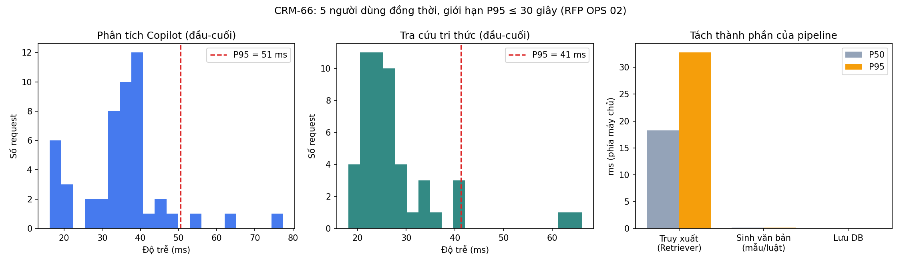

# Báo cáo kiểm thử tải CRM-66: 5 người dùng đồng thời, P95 độ trễ gói hỗ trợ

Ngày: 28/11/2026 | QA/Tester | Nhánh: develop-from-main (commit 5afa4e3) | Căn cứ: RFP Annex D, mục OPS 02

## 1. Tóm tắt

| Chỉ số | Yêu cầu (RFP OPS 02) | Kết quả đo | Kết luận |
|---|---|---|---|
| P95 độ trễ gói hỗ trợ (`POST /api/copilot/analyze`), 5 người dùng đồng thời | ≤ 30 giây | **51 ms** (50 request) | Đạt, với điều kiện đo nêu ở mục 6 |
| P95 toàn bộ 100 request (tra cứu tri thức + phân tích) | ≤ 30 giây | **47 ms** | Đạt, với điều kiện đo nêu ở mục 6 |
| Lỗi (HTTP không phải 200) | Báo cáo | 0/100 | Đạt |
| Request bị giữ lại do cờ nguy hiểm | Báo cáo | 10/50 request phân tích | Ghi nhận |
| Giới hạn call/token/chi phí, giới hạn nhà cung cấp | Báo cáo | **Không áp dụng**: backend chưa gọi mô hình AI thật | Chưa kiểm được |

Kết quả thấp hơn giới hạn 30 giây hơn 500 lần, nhưng con số này **không đại diện cho hệ thống có mô hình AI thật** (xem mục 5 và 6). Không nên dùng riêng con số này để kết luận G3.

## 2. Cách đo

- Công cụ: `docs/qa/load_test_p95.py` (Python asyncio + httpx). Lệnh chạy lại: xem đầu file script.
- Backend thật `app.main:app` chạy bằng uvicorn trong tiến trình của script, kết nối **PostgreSQL 16 thật** chạy trong Docker (không SQLite, script tự kiểm tra).
- 5 worker bất đồng bộ, mỗi worker dùng token của một tài khoản riêng (đăng nhập thật qua `POST /api/auth/login`).
- 100 request đo, chia đều: 50 tra cứu tri thức (`GET /api/knowledge/passages?q=...`) và 50 phân tích sự cố Copilot (`POST /api/copilot/analyze`). Trước đó có 10 request làm nóng (không tính).
- 10 mẫu ticket tiếng Việt xoay vòng (8 sự cố kỹ thuật thông thường, 1 nguy hiểm thật, 1 câu phủ định), 10 từ khóa tra cứu.
- Kho tri thức: 300 đoạn, đúng giả định của RFP mục 2 (300 đoạn tri thức hai dòng sản phẩm). Gồm 9 đoạn thật từ file CSV mẫu của dự án và **291 đoạn tổng hợp** (đánh dấu `metadata.synthetic = true`), chỉ dùng để đo tải, không dùng đánh giá chất lượng.
- Tách thời gian phía máy chủ bằng cách bọc 3 hàm của pipeline (không sửa mã của team): truy xuất (`search_knowledge_passages`), lưu DB (`_save_copilot_package_to_db`), sinh văn bản = tổng pipeline trừ hai phần trên.

## 3. Kết quả chi tiết (kho tri thức 300 đoạn)

| Nhóm | n | Trung bình | P50 | P95 | P99 | Lớn nhất |
|---|---:|---:|---:|---:|---:|---:|
| Phân tích Copilot, đầu-cuối | 50 | 35,0 ms | 35,5 ms | **50,5 ms** | 70,7 ms | 77,4 ms |
| Tra cứu tri thức, đầu-cuối | 50 | 27,6 ms | 25,1 ms | 41,2 ms | 64,1 ms | 66,1 ms |
| Toàn bộ 100 request | 100 | 31,3 ms | 28,6 ms | **47,2 ms** | 66,2 ms | 77,4 ms |
| Truy xuất (Retriever), phía máy chủ | 40 | 19,1 ms | 18,3 ms | 32,8 ms | 34,5 ms | 34,8 ms |
| Sinh văn bản (mẫu/luật), phía máy chủ | 40 | 0,12 ms | 0,13 ms | 0,16 ms | 0,16 ms | 0,16 ms |

Thời gian thực hiện 100 request: 0,64 giây, thông lượng khoảng 156 request/giây. Thời gian truy xuất và sinh văn bản chỉ tính cho 40 request không bị giữ lại (10 request bị giữ không gọi Retriever).

Biểu đồ phân bổ độ trễ: 

## 4. Dữ liệu thô

- `docs/qa/load_test_raw.csv`: từng request (thứ tự, loại, worker, HTTP, ms, số trích dẫn, bị giữ lại).
- `docs/qa/load_test_summary.json`: toàn bộ số liệu tổng hợp.
- `docs/qa/load_test_raw_9passages.csv`, `load_test_summary_9passages.json`, `load_test_latency_9passages.png`: lần chạy tham khảo với kho tri thức chỉ 9 đoạn thật, đo trên một máy khác (máy ảo đám mây của QA, 2 vCPU, 8 GB RAM). Không so sánh trực tiếp con số giữa hai máy; chỉ dùng để thấy xu hướng: kho nhỏ thì truy xuất nhanh hơn rõ rệt.

## 5. Phát hiện và điểm cần lưu ý

1. **Không có mô hình AI thật.** `copilot_engine.py` đọc biến `GEMINI_API_KEY`/`OPENAI_API_KEY` nhưng không có đoạn mã nào dùng khóa đó để gọi dịch vụ AI, và `requirements.txt` không có thư viện Gemini/OpenAI. Thời gian "sinh văn bản" (0,12 ms) chỉ là chạy mẫu có sẵn. Khi nhóm gắn mô hình thật, **bắt buộc đo lại** vì thời gian sinh sẽ chiếm phần lớn độ trễ. Các mục RFP về giới hạn call/token/chi phí (OPS 06) không kiểm được.
2. **Bước lưu DB không được đo.** Request `/api/copilot/analyze` trong kịch bản không gửi `ticket_id` nên pipeline không ghi `copilot_packages` (đo được 0 ms). Đường ghi DB còn có lỗi đã biết (CRM-67, CRM-68).
3. **Request bị giữ lại.** 10/50 request phân tích bị giữ (hold), không gọi Retriever. Trong đó 5 request là ticket nguy hiểm thật ("Tủ điện đang bốc khói, có tia lửa"), đúng mong đợi. 5 request còn lại là câu "Biến tần báo lỗi quá nhiệt sau 2 giờ chạy liên tục, kiểm tra quạt làm mát thế nào", bị coi là nguy hiểm. Đây là quan sát cần Dev/BA xác nhận xem có phải báo nhầm hay không (quá nhiệt có thể là tín hiệu an toàn hợp lệ). Không kết luận là lỗi.
4. **Request bị giữ lại xử lý nhanh hơn** (không truy xuất), nên không làm P95 tăng.
5. Tiêu chí CRM-47 (Jira) đặt P95 ≤ 5 giây, khác với RFP (≤ 30 giây). Kết quả đạt cả hai ngưỡng trong điều kiện đo này.
6. **Endpoint export PDF** (`GET /api/v1/copilot/{ticket_id}/export`) đã có nhưng báo lỗi 500 trên DB tạo từ `schema.sql` vì thiếu cột của `copilot_packages` (cùng nguyên nhân CRM-67). Không nằm trong phạm vi đo tải, ghi lại làm phát hiện kèm theo.

## 6. Hạn chế của phép đo (bắt buộc đọc)

- **Môi trường đo:** máy cá nhân của QA chạy Windows, Python 3.13.7, backend chạy bằng Python trên máy (không phải trong container backend của docker compose), PostgreSQL 16 trong Docker (`songnhat-db`, cổng 5432) trên cùng máy, không có độ trễ mạng. Cấu hình phần cứng: Intel Core i7-13650HX (14 nhân, 20 luồng), RAM 15,7 GB. Không phải môi trường vận hành của SongNhat. RFP ghi rõ chỉ tiêu hiệu năng "phải được benchmark trên môi trường thực tế".
- **Quy mô nhỏ:** 100 request trong chưa đến 1 giây, không phải tải kéo dài. Không đo được hành vi khi tải kéo dài, rò rỉ bộ nhớ hay giới hạn kết nối.
- **Kho tri thức tổng hợp:** 291/300 đoạn là dữ liệu tổng hợp để mô phỏng kích thước. Thời gian truy xuất phụ thuộc vào nội dung và chỉ mục thật; số liệu chỉ mang tính tham khảo.
- **Chưa có AI thật** (mục 5.1) và chưa đo chi phí.
- **Một lần chạy:** chưa lặp nhiều lần để báo cáo độ biến thiên.

## 7. Khuyến nghị

1. Chạy lại `load_test_p95.py` trên môi trường triển khai thực của nhóm (backend trong container) và ghi cấu hình vào báo cáo, trước khi dùng số liệu cho hồ sơ G3.
2. Khi gắn mô hình AI thật: chạy lại, tách rõ thời gian truy xuất và sinh, đếm các request bị giữ hoặc lỗi, và ghi chi phí.
3. Thêm `ticket_id` vào kịch bản để đo cả bước lưu DB sau khi CRM-67/CRM-68 được sửa.
4. Chạy lại với kho tri thức thật 300 đoạn đã duyệt khi có.
