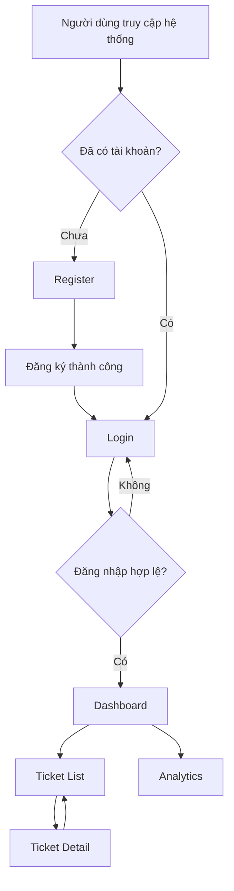

# BÁO CÁO THIẾT KẾ WIREFRAME – SUPPORT RESOLUTION AI

## 1. Giới thiệu dự án

**Tên dự án:** Support Resolution AI  
**Loại dự án:** Hệ thống quản lý và hỗ trợ giải quyết yêu cầu người dùng bằng trí tuệ nhân tạo (AI).  
**Công cụ thiết kế:** Figma  
**Repository:** [support-resolution-ai](https://github.com/thanhhai375/support-resolution-ai)

### 1.1. Mục tiêu

Dự án Support Resolution AI được xây dựng nhằm hỗ trợ doanh nghiệp tiếp nhận, quản lý và xử lý các yêu cầu hỗ trợ (Ticket) từ người dùng một cách hiệu quả.

Hệ thống hướng đến việc ứng dụng trí tuệ nhân tạo để hỗ trợ phân loại yêu cầu, đề xuất hướng giải quyết và nâng cao hiệu suất làm việc của nhân viên hỗ trợ.

### 1.2. Phạm vi thực hiện

Trong giai đoạn hiện tại, nhóm tập trung vào thiết kế Wireframe cho các màn hình chính của hệ thống bằng Figma.

Các màn hình được thiết kế nhằm mô phỏng bố cục, thành phần giao diện và luồng tương tác dự kiến trước khi triển khai lập trình Frontend và Backend.

---

## 2. Danh sách màn hình đã thiết kế

Hệ thống hiện có **6 màn hình Wireframe**.

| STT | Màn hình | Chức năng |
|---|---|---|
| 1 | Login | Đăng nhập vào hệ thống |
| 2 | Dashboard | Hiển thị tổng quan hoạt động |
| 3 | Ticket List | Quản lý danh sách yêu cầu hỗ trợ |
| 4 | Ticket Detail | Xem và xử lý chi tiết yêu cầu |
| 5 | Analytics | Thống kê và phân tích dữ liệu |
| 6 | Register | Đăng ký tài khoản mới |

### 2.1. Màn hình Login – Đăng nhập

**Mục đích:** Cho phép người dùng đăng nhập vào hệ thống bằng tài khoản đã được đăng ký.

**Các thành phần giao diện:**
- Logo và tên hệ thống Support AI.
- Trường nhập Email.
- Trường nhập Mật khẩu.
- Tùy chọn ghi nhớ đăng nhập.
- Liên kết quên mật khẩu.
- Nút Đăng nhập.

**Luồng hoạt động dự kiến:**

Người dùng nhập thông tin đăng nhập → Hệ thống kiểm tra thông tin → Nếu hợp lệ, chuyển đến Dashboard; nếu không hợp lệ, hiển thị thông báo lỗi.

### 2.2. Màn hình Dashboard – Trang tổng quan

**Mục đích:** Cung cấp cái nhìn tổng quan về tình trạng xử lý các yêu cầu hỗ trợ.

**Các thành phần giao diện:**
- Thanh điều hướng chính.
- Menu chức năng.
- Các thẻ thống kê Ticket.
- Khu vực hiển thị thông tin hoạt động.
- Khu vực hỗ trợ AI.

**Chức năng dự kiến:**
- Theo dõi tổng số Ticket.
- Theo dõi Ticket đang xử lý và đã hoàn thành.
- Truy cập nhanh các chức năng quản lý.
- Hiển thị thông tin hỗ trợ xử lý yêu cầu.

### 2.3. Màn hình Ticket List – Danh sách yêu cầu

**Mục đích:** Hiển thị và quản lý danh sách yêu cầu hỗ trợ của người dùng.

**Các thành phần giao diện:**
- Bảng danh sách Ticket.
- Mã Ticket.
- Tiêu đề yêu cầu.
- Trạng thái xử lý.
- Mức độ ưu tiên.
- Chức năng tìm kiếm và lọc dữ liệu.

**Luồng hoạt động dự kiến:**

Người dùng truy cập Ticket List → Tìm kiếm hoặc lựa chọn Ticket → Chuyển sang màn hình Ticket Detail.

### 2.4. Màn hình Ticket Detail – Chi tiết yêu cầu

**Mục đích:** Cho phép nhân viên hỗ trợ xem nội dung và xử lý từng yêu cầu cụ thể.

**Các thành phần giao diện:**
- Thông tin Ticket.
- Nội dung yêu cầu.
- Trạng thái xử lý.
- Thông tin người gửi.
- Khu vực phản hồi.
- Khu vực gợi ý hỗ trợ từ AI.

**Chức năng dự kiến:**
- Xem chi tiết yêu cầu.
- Cập nhật trạng thái xử lý.
- Nhập phản hồi.
- Tham khảo gợi ý giải quyết từ AI.

### 2.5. Màn hình Analytics – Thống kê và phân tích

**Mục đích:** Hỗ trợ theo dõi hiệu suất xử lý yêu cầu và đánh giá hoạt động của hệ thống.

**Các thành phần giao diện:**
- Thẻ chỉ số thống kê.
- Biểu đồ tổng hợp Ticket.
- Thống kê theo trạng thái.
- Thống kê hiệu suất xử lý.
- Khu vực phân tích dữ liệu.

**Chức năng dự kiến:**
- Theo dõi số lượng yêu cầu theo thời gian.
- Đánh giá tình trạng xử lý Ticket.
- Hỗ trợ phân tích và cải thiện hiệu quả vận hành.

### 2.6. Màn hình Register – Đăng ký tài khoản

**Mục đích:** Cho phép người dùng tạo tài khoản mới để sử dụng hệ thống Support Resolution AI.

**Các thành phần giao diện:**
- Tiêu đề tạo tài khoản.
- Trường nhập Họ và tên.
- Trường nhập Email.
- Trường nhập Mật khẩu.
- Trường nhập Xác nhận mật khẩu.
- Tùy chọn đồng ý điều khoản sử dụng.
- Nút Đăng ký tài khoản.
- Liên kết quay về màn hình Đăng nhập.

**Luồng hoạt động dự kiến:**

1. Người dùng truy cập màn hình Đăng ký.
2. Nhập đầy đủ thông tin cá nhân.
3. Nhập và xác nhận mật khẩu.
4. Đồng ý điều khoản sử dụng.
5. Nhấn nút Đăng ký tài khoản.
6. Hệ thống kiểm tra tính hợp lệ của dữ liệu.
7. Nếu đăng ký thành công, người dùng được chuyển đến màn hình Đăng nhập.

**Các điều kiện kiểm tra dự kiến:**
- Không để trống các trường bắt buộc.
- Email phải đúng định dạng.
- Mật khẩu phải đáp ứng yêu cầu bảo mật.
- Mật khẩu xác nhận phải trùng khớp.
- Email đăng ký không được trùng với tài khoản đã tồn tại.
- Người dùng phải đồng ý điều khoản sử dụng.

---

## 3. Luồng hoạt động của hệ thống

Luồng sử dụng dự kiến của hệ thống:

**Lưu ý:** Sơ đồ thể hiện luồng chức năng dự kiến. Việc liên kết Prototype và xử lý nghiệp vụ thực tế cần được hoàn thiện trong các giai đoạn tiếp theo.

---

## 4. Công cụ và tài nguyên sử dụng

| Công cụ | Mục đích |
|---|---|
| Figma | Thiết kế Wireframe và bố cục giao diện |
| GitHub | Quản lý mã nguồn và tài liệu dự án |
| Git | Quản lý phiên bản và nhánh làm việc |
| Codex | Hỗ trợ triển khai và chỉnh sửa mã nguồn |

### Liên kết thiết kế Figma

[**Xem toàn bộ Wireframe Support Resolution AI**](https://www.figma.com/design/TdNzic5TvynT8OociAhg76)

[**Xem màn hình Register**](https://www.figma.com/design/TdNzic5TvynT8OociAhg76?node-id=69-48)

---

## 5. Kết quả thực hiện

### 5.1. Kết quả đạt được

- Đã xây dựng Wireframe cho 6 màn hình chính.
- Thiết kế các màn hình theo phong cách giao diện thống nhất.
- Bổ sung màn hình đăng ký tài khoản.
- Xác định các thành phần giao diện cần thiết.
- Xây dựng luồng hoạt động dự kiến giữa các chức năng.
- Tạo nền tảng thiết kế để triển khai Frontend trong các giai đoạn tiếp theo.

### 5.2. Hạn chế hiện tại

- Các màn hình hiện chủ yếu ở mức thiết kế Wireframe.
- Chưa tích hợp Backend và cơ sở dữ liệu.
- Chưa triển khai chức năng đăng ký, đăng nhập thực tế.
- Chưa tích hợp mô hình AI vào hệ thống.
- Chưa hoàn thiện toàn bộ tương tác Prototype giữa các màn hình.
- Chưa thực hiện kiểm thử chức năng trên ứng dụng hoàn chỉnh.

---

## 6. Hướng phát triển tiếp theo

1. Hoàn thiện Prototype và liên kết điều hướng giữa các màn hình.
2. Xây dựng giao diện Frontend dựa trên Wireframe.
3. Phát triển API đăng ký, đăng nhập và xác thực người dùng.
4. Xây dựng chức năng quản lý Ticket.
5. Tích hợp AI hỗ trợ phân loại và đề xuất giải pháp xử lý.
6. Phát triển chức năng thống kê và báo cáo.
7. Thực hiện kiểm thử và hoàn thiện hệ thống.

---

## 7. Kết luận

Trong giai đoạn thiết kế, nhóm đã xây dựng được 6 màn hình Wireframe cơ bản cho hệ thống Support Resolution AI, bao gồm các chức năng xác thực người dùng, quản lý Ticket, xem chi tiết yêu cầu và thống kê dữ liệu.

Việc bổ sung màn hình Register giúp hoàn thiện hơn phần thiết kế giao diện xác thực người dùng, tạo cơ sở để triển khai quy trình đăng ký và đăng nhập trong giai đoạn phát triển tiếp theo.

Các kết quả hiện tại là nền tảng quan trọng để nhóm tiếp tục xây dựng hệ thống hỗ trợ người dùng có tích hợp trí tuệ nhân tạo.