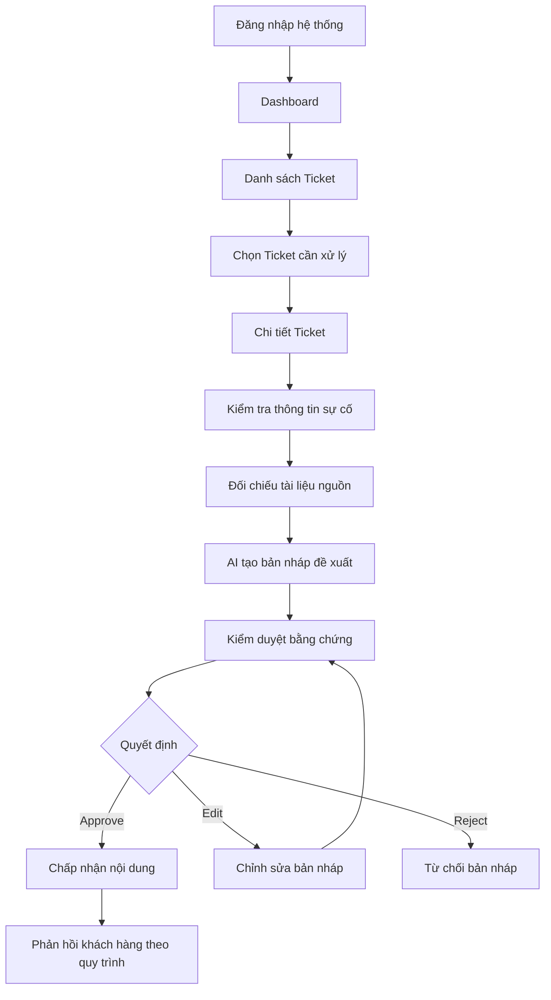

# BÁO CÁO THIẾT KẾ GIAO DIỆN UI/UX
# SONGNHAT – SUPPORT RESOLUTION AI

**Tên thiết kế:** SongNhat — Evidence-based Staff Workspace  
**Tên hệ thống:** Support Resolution AI  
**Đơn vị được thể hiện trong thiết kế:** Song Nhật (SONGNHAT)  
**Công cụ thiết kế:** Figma  
**Loại sản phẩm:** UI/UX Mockup – Hệ thống hỗ trợ kỹ thuật tích hợp AI  
**Số lượng màn hình:** 05  
**Kích thước thiết kế:** 1440 × 900 px/màn hình  
**Ngày lập báo cáo:** 08/11/2026

**Liên kết Figma:** [Xem thiết kế SongNhat trên Figma](https://www.figma.com/design/stUs8Z4ZWkmxlfmtTwEvH7)

---

## 1. GIỚI THIỆU TỔNG QUAN

### 1.1. Giới thiệu hệ thống

Support Resolution AI là hệ thống hỗ trợ tiếp nhận, quản lý và giải quyết các yêu cầu hỗ trợ kỹ thuật liên quan đến thiết bị công nghiệp.

Thiết kế giao diện được xây dựng theo mô hình **Evidence-based Staff Workspace**, tức không gian làm việc dành cho nhân viên, trong đó các đề xuất của trí tuệ nhân tạo cần được đối chiếu với bằng chứng và tài liệu kỹ thuật.

Hệ thống hướng đến việc kết hợp giữa khả năng phân tích thông tin của AI và chuyên môn của nhân viên hỗ trợ để nâng cao chất lượng xử lý sự cố.

Trong bản thiết kế, hệ thống đặc biệt chú trọng đến các tình huống liên quan đến an toàn thiết bị, chẳng hạn như quá nhiệt biến tần, dòng rò động cơ hoặc các vấn đề cần chuyển cấp kỹ thuật.

### 1.2. Mục tiêu thiết kế

- Xây dựng giao diện quản lý yêu cầu hỗ trợ kỹ thuật tập trung.
- Giúp nhân viên theo dõi tình trạng và mức độ ưu tiên của Ticket.
- Hỗ trợ AI tạo bản nháp phản hồi dựa trên tài liệu tham chiếu.
- Cho phép nhân viên kiểm tra nguồn thông tin trước khi sử dụng đề xuất của AI.
- Hiển thị cảnh báo an toàn đối với các sự cố có nguy cơ cao.
- Hỗ trợ quy trình kiểm duyệt có sự tham gia của con người.
- Tạo nền tảng giao diện để phát triển hệ thống thực tế.

### 1.3. Đối tượng sử dụng

**Support Agent – Nhân viên hỗ trợ**

Là người trực tiếp tiếp nhận yêu cầu, theo dõi Ticket, xem thông tin sự cố và sử dụng các đề xuất từ AI để chuẩn bị phản hồi khách hàng.

**Technical Approver – Người kiểm duyệt kỹ thuật**

Là người có trách nhiệm đánh giá các thông tin kỹ thuật, kiểm tra bằng chứng, xem xét rủi ro an toàn và phê duyệt nội dung trước khi sử dụng trong quy trình hỗ trợ.

Hai vai trò được thể hiện trong giao diện đăng nhập. Quy tắc phân quyền chi tiết cần được xác định trong giai đoạn triển khai hệ thống.

---

## 2. PHẠM VI THIẾT KẾ

Bản Figma hiện tại gồm 5 màn hình chính:

| STT | Tên màn hình | Chức năng chính |
|---|---|---|
| 01 | Login | Đăng nhập vào hệ thống |
| 02 | Dashboard | Theo dõi tổng quan hoạt động hỗ trợ |
| 03 | Ticket List | Quản lý và tìm kiếm yêu cầu hỗ trợ |
| 04 | Ticket Detail | Xem chi tiết Ticket, bằng chứng và đề xuất AI |
| 05 | AI Evidence Review | Kiểm tra nguồn và quyết định phê duyệt nội dung AI |

Các màn hình sử dụng kích thước 1440 × 900 px, phù hợp với giao diện ứng dụng web dành cho máy tính.

---

## 3. PHÂN TÍCH CHI TIẾT CÁC MÀN HÌNH

### 3.1. Màn hình 01 – Login

**Tên trong Figma:** `01 — Login | Support Agent / Technical Approver`

**Mục đích**

Màn hình Login cung cấp giao diện xác thực để nhân viên truy cập không gian làm việc của hệ thống Support Resolution AI.

**Bố cục giao diện**

Màn hình được chia thành hai khu vực chính:

**Khu vực bên trái – Nhận diện thương hiệu**

- Logo SN SONGNHAT.
- Tên hệ thống Support Resolution AI.
- Giới thiệu trợ lý AI hỗ trợ xử lý sự cố và vận hành thiết bị công nghiệp.
- Hình minh họa trợ lý AI.
- Thông điệp về tra cứu tài liệu, gợi ý xử lý và an toàn.

**Khu vực bên phải – Biểu mẫu đăng nhập**

- Tiêu đề: Đăng nhập vào hệ thống.
- Mô tả không gian làm việc của nhân viên hỗ trợ.
- Nhãn vai trò Support Agent và Technical Approver.
- Trường Email công việc.
- Trường Mật khẩu.
- Chức năng hiển thị mật khẩu.
- Tùy chọn Ghi nhớ đăng nhập.
- Liên kết Quên mật khẩu.
- Nút Đăng nhập.
- Thông điệp về truy cập có kiểm soát và bảo vệ dữ liệu kỹ thuật.

**Luồng xử lý dự kiến**

1. Người dùng truy cập trang đăng nhập.
2. Nhập email công việc và mật khẩu.
3. Nhấn nút Đăng nhập.
4. Hệ thống xác thực thông tin.
5. Nếu hợp lệ, người dùng được chuyển đến Dashboard.
6. Nếu không hợp lệ, hệ thống hiển thị thông báo lỗi.

**Yêu cầu chức năng khi triển khai**

- Kiểm tra trường bắt buộc.
- Kiểm tra định dạng email.
- Xác thực thông tin đăng nhập.
- Quản lý phiên đăng nhập.
- Bảo vệ thông tin mật khẩu.
- Phân quyền truy cập theo vai trò.

---

### 3.2. Màn hình 02 – Dashboard

**Tên trong Figma:** `02 — Dashboard | SongNhat Operations`

**Mục đích**

Dashboard là trang tổng quan giúp nhân viên theo dõi tình trạng hoạt động của hệ thống hỗ trợ và nhận biết các yêu cầu cần ưu tiên xử lý.

**Các khu vực chính**

**A. Thanh điều hướng bên trái (Sidebar)**

Gồm các mục:

- Tổng quan.
- Danh sách ticket.
- Tạo ticket.
- Thư viện tài liệu.
- Báo cáo & Thống kê.
- Cài đặt.
- Thông tin tài khoản nhân viên.

**B. Thanh công cụ phía trên (Topbar)**

- Tìm kiếm Ticket, thiết bị và tài liệu.
- Trợ giúp.
- Thông báo.
- Thông tin tài khoản.

**C. Các thẻ thống kê KPI**

Dữ liệu minh họa trên giao diện:

| Chỉ số | Giá trị hiển thị | Thông tin bổ sung |
|---|---:|---|
| Tổng Ticket | 256 | Tăng 12,8% |
| Tài liệu | 102 | Tăng 9,6% |
| Tiến độ dịch vụ | 98 | Tăng 6,1% |
| Chuyển cấp kỹ thuật | 56 | Tăng 15,3% |
| Cảnh báo an toàn | 8 | 2 ca mới |

Bộ lọc thời gian đang được hiển thị là **7 ngày gần nhất**.

Các số liệu trên là dữ liệu minh họa trong bản thiết kế, chưa phải dữ liệu vận hành thực tế.

**D. Biểu đồ thống kê**

Gồm hai khu vực:

- Xu hướng Ticket: thể hiện số lượng yêu cầu tiếp nhận theo ngày.
- Phân bổ Ticket theo danh mục: thể hiện cơ cấu yêu cầu hỗ trợ.

**E. Cảnh báo an toàn gần đây**

Thiết kế hiển thị các tình huống như:

- TK-1042: Quá nhiệt biến tần, nguy cơ cháy nổ.
- TK-1037: Dòng rò động cơ vượt ngưỡng an toàn.

**F. Ticket cần xử lý**

| Trạng thái | Số lượng minh họa |
|---|---:|
| Đang xử lý | 48 |
| Chờ duyệt | 18 |
| Quá hạn | 6 |

**Ý nghĩa thiết kế**

Dashboard giúp nhân viên xác định nhanh khối lượng công việc, tình trạng xử lý và những vấn đề an toàn cần được ưu tiên.

---

### 3.3. Màn hình 03 – Ticket List

**Tên trong Figma:** `03 — Ticket List | Status & Category Filters`

**Mục đích**

Màn hình Ticket List cho phép quản lý danh sách các yêu cầu hỗ trợ kỹ thuật, phục vụ quá trình tìm kiếm, phân loại và lựa chọn Ticket cần xử lý.

**Các thành phần giao diện**

**A. Khu vực tiêu đề**

- Tiêu đề Danh sách ticket.
- Mô tả quản lý, phân loại và xử lý yêu cầu hỗ trợ kỹ thuật.
- Nút `+ Tạo ticket`.

**B. Thanh tìm kiếm và bộ lọc**

- Tìm kiếm theo mã Ticket hoặc thiết bị.
- Bộ lọc trạng thái.
- Bộ lọc danh mục.
- Bộ lọc mức độ ưu tiên.

**C. Các danh mục Ticket**

| Danh mục | Số lượng minh họa |
|---|---:|
| Tất cả | 256 |
| Tài liệu | 102 |
| Tiến độ dịch vụ | 98 |
| Chuyển cấp | 56 |
| Cảnh báo an toàn | 8 |

Các danh mục này được thể hiện dưới dạng bộ lọc. Không nên mặc định cộng tất cả số lượng để tính tổng vì các nhóm có thể chồng lấp.

**D. Bảng dữ liệu Ticket**

Các cột được thiết kế:

| Cột | Ý nghĩa |
|---|---|
| Mã Ticket | Mã định danh yêu cầu |
| Tiêu đề | Nội dung tóm tắt |
| Danh mục | Nhóm yêu cầu hỗ trợ |
| Ưu tiên | Mức độ cần xử lý |
| Trạng thái | Tình trạng hiện tại |
| Cập nhật | Thời điểm cập nhật |

**Ví dụ dữ liệu trong thiết kế**

| Mã Ticket | Nội dung | Mức ưu tiên | Trạng thái |
|---|---|---|---|
| TK-1042 | Quá nhiệt biến tần khi vận hành | Khẩn cấp | Đang xử lý |
| TK-1041 | Cần tài liệu cài đặt biến tần VFD | Cao | Chờ duyệt |
| TK-1040 | Cập nhật tiến độ bảo trì động cơ | Trung bình | Đang xử lý |
| TK-1039 | Lỗi quá dòng khi khởi động | Cao | Mới |
| TK-1038 | Hướng dẫn cấu hình thông số | Thấp | Đã giải quyết |

Bảng có thành phần phân trang, hiển thị 5 bản ghi trong tổng số 256 Ticket minh họa.

**Luồng xử lý dự kiến**

1. Nhân viên mở danh sách Ticket.
2. Sử dụng tìm kiếm hoặc bộ lọc.
3. Xác định Ticket cần xử lý.
4. Chọn Ticket.
5. Chuyển đến màn hình Ticket Detail.

---

### 3.4. Màn hình 04 – Ticket Detail

**Tên trong Figma:** `04 — Ticket Detail | Evidence & Human Review`

**Mục đích**

Màn hình Ticket Detail cung cấp thông tin chi tiết về yêu cầu hỗ trợ, tài liệu bằng chứng và bản nháp giải pháp do AI đề xuất.

Đây là màn hình quan trọng vì kết hợp dữ liệu sự cố, bằng chứng kỹ thuật và quyết định của nhân viên.

**A. Thông tin Ticket**

Ticket được sử dụng làm ví dụ:

- **Mã Ticket:** TK-1042.
- **Tiêu đề:** Quá nhiệt biến tần khi vận hành.
- **Trạng thái:** Đang xử lý.
- **Mức ưu tiên:** Khẩn cấp.
- **Danh mục:** Chuyển cấp kỹ thuật.
- **Người tạo:** Nguyễn An.
- **Thời điểm tạo:** 07/11/2026 10:42.

**B. Thông tin yêu cầu**

- Khách hàng: Công ty ABC.
- Người liên hệ: Nguyễn An.
- Thiết bị: Biến tần SN-VFD-750.
- Địa điểm: Xưởng sản xuất A.

**C. Mô tả sự cố**

Biến tần xuất hiện cảnh báo quá nhiệt sau khoảng 15 phút vận hành, mặc dù quạt làm mát vẫn hoạt động.

Người gửi yêu cầu được hướng dẫn kiểm tra và xử lý an toàn.

**D. Bảng bằng chứng (Citations)**

Thiết kế thể hiện hai nguồn tài liệu:

| Nguồn | Nội dung | Vị trí |
|---|---|---|
| [1] | Hướng dẫn xử lý lỗi quá nhiệt | Trang 45 |
| [2] | Thông số môi trường vận hành | Trang 12 |

Mỗi nguồn có liên kết mở tài liệu PDF gốc ở dạng minh họa.

Việc trích dẫn tài liệu giúp nhân viên xác minh cơ sở của đề xuất thay vì phụ thuộc hoàn toàn vào câu trả lời AI.

**E. Cảnh báo an toàn**

Giao diện hiển thị cảnh báo khẩn cấp liên quan đến nguy cơ quá nhiệt và cháy.

Định hướng xử lý được thể hiện trong thiết kế là dừng vận hành, cô lập nguồn và chuyển nhân sự kỹ thuật có thẩm quyền kiểm tra.

**F. Bản nháp AI gợi ý**

Bản nháp đề xuất các bước:

1. Khuyến nghị dừng vận hành để bảo đảm an toàn.
2. Đề nghị kỹ thuật viên có thẩm quyền kiểm tra hệ thống làm mát và khe tản nhiệt.
3. Đối chiếu thông số môi trường với giới hạn trong tài liệu kỹ thuật.
4. Chuyển cấp kỹ thuật để xác minh nguyên nhân trước khi vận hành trở lại.

Bản nháp có thông tin dẫn nguồn và trạng thái chờ nhân viên kiểm duyệt.

**G. Các thao tác kiểm duyệt**

- **Approve:** Duyệt đề xuất.
- **Edit:** Chỉnh sửa đề xuất.
- **Reject:** Từ chối đề xuất.

**Ý nghĩa thiết kế**

Màn hình Ticket Detail thể hiện nguyên tắc AI hỗ trợ ra quyết định nhưng không thay thế trách nhiệm kiểm tra chuyên môn của con người.

---

### 3.5. Màn hình 05 – AI Evidence Review

**Tên trong Figma:** `05 — AI Evidence Review | Verify Sources & Decision`

**Mục đích**

Màn hình AI Evidence Review được thiết kế để nhân viên kiểm tra nội dung AI đề xuất trước khi sử dụng làm phản hồi khách hàng.

Đây là bước kiểm soát chất lượng thông tin và an toàn kỹ thuật.

**A. Thông tin kiểm duyệt**

- Ticket: TK-1042.
- Trạng thái: Chờ kiểm duyệt.
- Mức rủi ro: Nguy cơ cao.
- Người duyệt minh họa: Minh Von.

**B. Khu vực bằng chứng và tài liệu nguồn**

Giao diện cho phép đối chiếu các khẳng định của AI với tài liệu tham chiếu.

Hai nguồn được hiển thị:

**Nguồn [1] – Trang 45**

Tài liệu hướng dẫn xử lý lỗi quá nhiệt biến tần, liên quan đến việc dừng thiết bị và kiểm tra an toàn trước khi xử lý hệ thống làm mát.

**Nguồn [2] – Trang 12**

Tài liệu về điều kiện môi trường và giới hạn vận hành.

Các liên kết mở tài liệu PDF được ghi là minh họa trong bản thiết kế.

**C. Cảnh báo an toàn khẩn cấp**

Thiết kế nhấn mạnh rằng người dùng không nên được hướng dẫn can thiệp vào phần điện khi chưa cô lập nguồn.

Những tình huống có nguy cơ cao cần được chuyển cho kỹ thuật viên đủ thẩm quyền để kiểm tra.

**D. AI Draft – Human-in-the-loop**

Giao diện hiển thị bản nháp phản hồi khách hàng do AI hỗ trợ soạn thảo.

Nội dung bản nháp:

- Thông báo tình trạng quá nhiệt.
- Đề nghị tạm ngừng vận hành.
- Khuyến nghị liên hệ kỹ thuật viên.
- Đề cập đến tài liệu nguồn [1] và [2].
- Giữ văn phong chuyên nghiệp, phù hợp với bộ phận hỗ trợ kỹ thuật.

Bản nháp có nhãn dẫn nguồn và cần kiểm tra an toàn.

**E. Quyết định kiểm duyệt**

Nhân viên có ba lựa chọn:

| Thao tác | Ý nghĩa |
|---|---|
| Approve | Chấp nhận bản nháp sau khi kiểm tra |
| Edit | Chỉnh sửa nội dung trước khi chấp nhận |
| Reject | Từ chối bản nháp không phù hợp |

**Ý nghĩa thiết kế**

Màn hình này cụ thể hóa nguyên tắc **Human-in-the-loop**, trong đó AI hỗ trợ tạo nội dung, còn con người chịu trách nhiệm đánh giá và quyết định việc sử dụng nội dung đó.

---

## 4. LUỒNG HOẠT ĐỘNG DỰ KIẾN

### 4.1. Luồng xử lý Ticket

Sơ đồ trên mô tả luồng nghiệp vụ đề xuất dựa trên các màn hình. Không đồng nghĩa rằng toàn bộ thao tác đã được lập trình hoặc liên kết Prototype.

### 4.2. Luồng xử lý sự cố nguy cơ cao

1. Tiếp nhận Ticket có cảnh báo an toàn.
2. Xác định mức độ ưu tiên và nguy cơ.
3. Hiển thị thông tin sự cố cho nhân viên.
4. Đối chiếu tài liệu kỹ thuật.
5. AI hỗ trợ xây dựng bản nháp.
6. Nhân viên kiểm tra nội dung và nguồn dẫn.
7. Nếu cần, chuyển cấp cho người có thẩm quyền kỹ thuật.
8. Chỉ sử dụng nội dung phản hồi sau khi đáp ứng quy trình kiểm duyệt.

---

## 5. NGUYÊN TẮC THIẾT KẾ UI/UX

### 5.1. Tính nhất quán

Các màn hình quản lý sử dụng chung bố cục Sidebar, Topbar, tiêu đề và khu vực nội dung.

Việc sử dụng cấu trúc thống nhất giúp người dùng dễ dàng chuyển đổi giữa các chức năng.

### 5.2. Phân cấp thông tin

Thông tin được tổ chức theo mức độ quan trọng:

- Tiêu đề và trạng thái công việc.
- Chỉ số thống kê hoặc thông tin Ticket.
- Nội dung chi tiết.
- Bằng chứng và cảnh báo.
- Hành động xử lý.

### 5.3. Nhấn mạnh cảnh báo an toàn

Những tình huống nguy hiểm được thể hiện bằng khu vực cảnh báo riêng, giúp người dùng dễ nhận biết các vấn đề cần ưu tiên.

### 5.4. Minh bạch nguồn thông tin AI

Các đề xuất AI có khu vực tài liệu tham chiếu và vị trí trang tương ứng.

Thiết kế giúp nhân viên biết đề xuất được xây dựng dựa trên nguồn nào và có thể kiểm tra lại thông tin.

### 5.5. Kiểm soát bởi con người

Các thao tác Approve, Edit và Reject được đặt trực tiếp trong quy trình xử lý.

Điều này hỗ trợ kiểm soát nội dung AI trước khi sử dụng trong hoạt động hỗ trợ khách hàng.

---

## 6. PHÂN TÍCH YÊU CẦU CHỨC NĂNG

Các yêu cầu sau được đề xuất từ giao diện để phục vụ giai đoạn phát triển.

| Mã | Chức năng | Mô tả | Mức ưu tiên đề xuất |
|---|---|---|---|
| FR-01 | Đăng nhập | Xác thực nhân viên | Cao |
| FR-02 | Phân quyền | Phân biệt quyền Support Agent và Technical Approver | Cao |
| FR-03 | Dashboard | Hiển thị số liệu tổng quan | Trung bình |
| FR-04 | Quản lý Ticket | Xem, tìm kiếm và lọc Ticket | Cao |
| FR-05 | Chi tiết Ticket | Hiển thị thông tin và lịch sử yêu cầu | Cao |
| FR-06 | Quản lý tài liệu | Tra cứu tài liệu kỹ thuật | Cao |
| FR-07 | AI Draft | Hỗ trợ tạo bản nháp phản hồi | Cao |
| FR-08 | Citations | Hiển thị nguồn và trang tham chiếu | Cao |
| FR-09 | Safety Warning | Cảnh báo rủi ro an toàn | Cao |
| FR-10 | Human Review | Duyệt, sửa hoặc từ chối bản nháp | Cao |
| FR-11 | Thông báo | Thông báo Ticket cần xử lý | Trung bình |
| FR-12 | Báo cáo | Tổng hợp chỉ số vận hành | Trung bình |

---

## 7. YÊU CẦU PHI CHỨC NĂNG ĐỀ XUẤT

### 7.1. Bảo mật

- Xác thực người dùng trước khi truy cập dữ liệu.
- Phân quyền theo vai trò.
- Bảo vệ thông tin khách hàng và tài liệu kỹ thuật.
- Kiểm soát truy cập đến tài liệu nguồn.
- Ghi nhận lịch sử thao tác phê duyệt.

### 7.2. Khả năng sử dụng

- Giao diện rõ ràng, dễ thao tác.
- Trạng thái Ticket dễ phân biệt.
- Cảnh báo quan trọng dễ nhận biết.
- Nội dung AI dễ đọc và dễ kiểm tra.

### 7.3. Độ tin cậy

- Dữ liệu Ticket cần được cập nhật nhất quán.
- Các nguồn trích dẫn phải liên kết đúng tài liệu và vị trí tham chiếu.
- Cần xử lý trường hợp AI không tìm thấy bằng chứng phù hợp.
- Không tự động coi nội dung AI là kết luận kỹ thuật đã được xác minh.

### 7.4. Khả năng mở rộng

- Có thể bổ sung danh mục Ticket mới.
- Có thể mở rộng thư viện tài liệu.
- Có thể bổ sung vai trò và quy trình phê duyệt.
- Có thể phát triển thêm các màn hình quản trị và thống kê.

---

## 8. ĐỀ XUẤT KIỂM THỬ

| Test Case | Nội dung kiểm thử | Kết quả mong đợi |
|---|---|---|
| TC-01 | Đăng nhập hợp lệ | Truy cập Dashboard |
| TC-02 | Đăng nhập sai mật khẩu | Hiển thị thông báo lỗi |
| TC-03 | Tìm kiếm Ticket theo mã | Trả về Ticket phù hợp |
| TC-04 | Lọc Ticket theo trạng thái | Danh sách được lọc chính xác |
| TC-05 | Mở chi tiết Ticket | Hiển thị đúng thông tin |
| TC-06 | Xem tài liệu nguồn | Mở đúng tài liệu tham chiếu |
| TC-07 | AI không có nguồn phù hợp | Hiển thị cảnh báo hoặc yêu cầu kiểm tra |
| TC-08 | Duyệt bản nháp | Ghi nhận quyết định phê duyệt |
| TC-09 | Chỉnh sửa bản nháp | Lưu nội dung được chỉnh sửa |
| TC-10 | Từ chối bản nháp | Ghi nhận trạng thái từ chối |
| TC-11 | Ticket có nguy cơ cao | Hiển thị cảnh báo an toàn |
| TC-12 | Người dùng không đủ quyền duyệt | Không cho thực hiện thao tác phê duyệt |

**Ghi chú:** Đây là bộ test case đề xuất để kiểm thử sau khi hệ thống được phát triển, chưa phải kết quả kiểm thử thực tế.

---

## 9. KẾT QUẢ THIẾT KẾ

### 9.1. Các nội dung đã thể hiện trong Figma

- Thiết kế 5 màn hình giao diện web.
- Xây dựng giao diện đăng nhập cho nhân viên.
- Thiết kế Dashboard với các chỉ số và biểu đồ.
- Thiết kế danh sách Ticket có tìm kiếm, bộ lọc và phân trang.
- Thiết kế màn hình chi tiết Ticket.
- Bổ sung khu vực bằng chứng và tài liệu trích dẫn.
- Thể hiện bản nháp phản hồi AI.
- Thiết kế màn hình kiểm duyệt AI.
- Bổ sung các hành động Approve, Edit và Reject.
- Nhấn mạnh các cảnh báo liên quan đến an toàn thiết bị.

### 9.2. Những nội dung chưa được xác nhận hoàn thành

- Chức năng đăng nhập và xác thực thực tế.
- Kết nối API và cơ sở dữ liệu.
- Tích hợp mô hình AI hoạt động thực tế.
- Hệ thống tìm kiếm và truy xuất tài liệu.
- Kiểm tra tính chính xác của các trích dẫn PDF.
- Phân quyền nghiệp vụ.
- Lưu lịch sử kiểm duyệt.
- Tích hợp chức năng gửi phản hồi khách hàng.
- Kiểm thử và triển khai ứng dụng.

Các nội dung này cần được xác minh riêng trong repository hoặc môi trường chạy thực tế.

---

## 10. HƯỚNG PHÁT TRIỂN TIẾP THEO

### Giai đoạn 1 – Hoàn thiện thiết kế

- Rà soát bố cục và tính nhất quán giữa các màn hình.
- Hoàn thiện tương tác Prototype.
- Xác định trạng thái lỗi, trạng thái rỗng và trạng thái tải dữ liệu.
- Hoàn thiện quy trình phân quyền và kiểm duyệt.

### Giai đoạn 2 – Phát triển Frontend

- Xây dựng giao diện theo bản thiết kế Figma.
- Tạo các thành phần dùng chung.
- Triển khai điều hướng.
- Tích hợp biểu mẫu và bảng dữ liệu.
- Kết nối Frontend với API.

### Giai đoạn 3 – Phát triển Backend

- Xây dựng chức năng xác thực và phân quyền.
- Xây dựng API quản lý Ticket.
- Quản lý dữ liệu thiết bị và khách hàng.
- Quản lý tài liệu kỹ thuật.
- Lưu lịch sử thao tác và quyết định phê duyệt.

### Giai đoạn 4 – Tích hợp AI

- Tích hợp chức năng truy xuất tài liệu.
- Tạo bản nháp phản hồi có dẫn nguồn.
- Xây dựng cơ chế kiểm tra bằng chứng.
- Xử lý các trường hợp thiếu thông tin hoặc có rủi ro cao.
- Kết hợp quy trình kiểm duyệt của nhân viên.

### Giai đoạn 5 – Kiểm thử và hoàn thiện

- Kiểm thử chức năng.
- Kiểm thử API.
- Kiểm thử phân quyền.
- Kiểm thử luồng xử lý Ticket.
- Đánh giá chất lượng trích dẫn và phản hồi AI.
- Kiểm thử các tình huống cảnh báo an toàn.
- Hoàn thiện tài liệu và triển khai hệ thống.

---

## 11. KẾT LUẬN

Bản thiết kế **SongNhat – Evidence-based Staff Workspace** đã mô tả được giao diện làm việc dành cho nhân viên hỗ trợ kỹ thuật, gồm 5 màn hình từ đăng nhập, theo dõi hoạt động, quản lý Ticket đến kiểm tra bằng chứng và phê duyệt nội dung AI.

Điểm nổi bật của thiết kế là sự kết hợp giữa **quản lý Ticket, truy xuất tài liệu có dẫn nguồn, cảnh báo an toàn và kiểm duyệt bởi con người**.

Thay vì chỉ xây dựng một hệ thống AI trả lời tự động, thiết kế hướng đến quy trình hỗ trợ có kiểm soát, trong đó nhân viên có thể đánh giá cơ sở của từng đề xuất và đưa ra quyết định phù hợp.

Đây là nền tảng giao diện để nhóm tiếp tục phát triển hệ thống Support Resolution AI theo hướng minh bạch, có trách nhiệm và phù hợp với hoạt động hỗ trợ thiết bị công nghiệp.

---

## 12. TÀI LIỆU THAM KHẢO

**Figma Design:** [SongNhat — Evidence-based Staff Workspace • UI/UX Mockup](https://www.figma.com/design/stUs8Z4ZWkmxlfmtTwEvH7/SongNhat-%E2%80%94-Evidence-based-Staff-Workspace-%E2%80%A2-UI-UX-Mockup?node-id=0-1)

**Phạm vi tài liệu:** Báo cáo được xây dựng từ cấu trúc màn hình và nội dung giao diện trong file Figma. Các luồng nghiệp vụ, yêu cầu kỹ thuật và test case chưa được triển khai được ghi rõ là đề xuất.